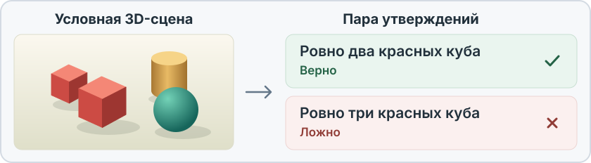
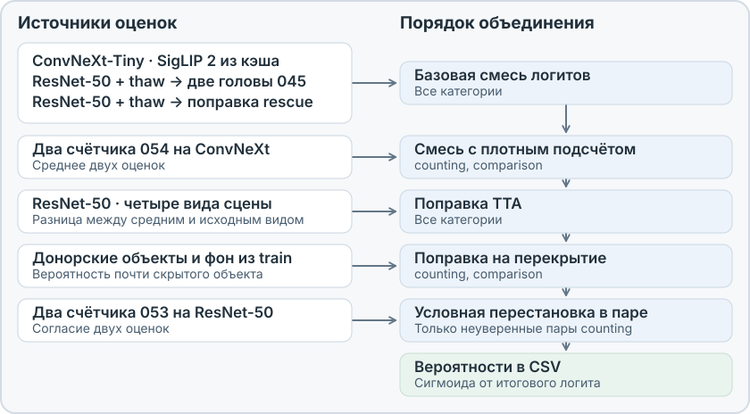

# Visual Reasoning — проверка утверждений о 3D-сценах

Для сцены с кубами, сферами и цилиндрами модель оценивает вероятность истинности каждого текстового утверждения. В нашем решении объектные модели находят фигуры и их атрибуты, а логический исполнитель проверяет условия из текста. SigLIP и отдельный счётчик дополняют объектную ветку.

**0,99978 ROC-AUC на публичном лидерборде Kaggle** у финальной композиции `057_quality` (Version 42). [Запись результата](KaggleTemplate.md#public-подтверждение-057-и-ограниченная-серия-усиления-results-10)

[Ноутбук Kaggle](notebooks/base.ipynb) · [Запуск](#запуск-на-kaggle) · [Данные](docs/data.md) · [Журнал экспериментов](KaggleTemplate.md)

## Данные и оценка

На входе JPEG 240 × 160 и утверждение на английском. Есть **5 000** сцен для обучения, **1 000** для валидации и **6 000** для теста. В каждой паре по одной сцене и категории верно ровно одно утверждение. На тесте восстанавливаем пары по `image` и `category`. Прогнозы записываются в `final_submission.csv` с колонками `id,label`. [Схема данных и категории](docs/data.md)

На исторической валидации `057_quality` получила **0,99986156 ROC-AUC**, **6 ошибок на 3 000 пар** и **0 ничьих**. ROC-AUC оценивает ранжирование всех строк, а ошибка в паре означает, что ложное утверждение получило более высокий балл, чем истинное. Один и тот же `val` использовался для серии абляций и выбора компонентов. [Исторический протокол и расчёт метрик](KaggleTemplate.md#финальный-аудит057-перед-подготовкой-пакета)

## Как работает решение

- **Объекты и текст.** Парсер приводит разные формулировки к одним и тем же операциям, например к точному подсчёту или проверке пространственного отношения. ConvNeXt строит таблицу объектов. Две головы `045_union` оценивают объединённые кандидаты исторических детекторов. Логический исполнитель использует вероятности атрибутов и координаты фигур. [Парсер](src/programs.py) · [Исполнитель](src/reasoning.py) · [Объединение кандидатов](src/union.py)
- **Смесь.** ConvNeXt, SigLIP и две головы `045_union` дают базовые логиты. К ним добавляется поправка за дополнительные объектные кандидаты. Для `counting` и `comparison` четверть веса в смеси получает среднее двух счётчиков `054_count`, которые оценивают количество по плотным картам. [Композиция](src/evidence.py) · [Счётчик](src/counter.py)
- **Поправки.** ResNet-50 добавляет разницу между средней оценкой четырёх преобразований и оценкой исходного кадра. В задачах подсчёта и сравнения учитывается вероятность почти полностью закрытой фигуры, оценённая по `train`. Согласие двух вспомогательных счётчиков `053_count` может поменять местами оценки неуверенной пары `counting`. Сигмоида переводит итоговые логиты в вероятности при записи CSV. [Формула и порядок операций](KaggleTemplate.md#финальный-аудит057-перед-подготовкой-пакета)

## Что показали эксперименты

| Историческая валидация | ROC-AUC ↑ | Ошибки в парах ↓ | Ничьи |
| --- | ---: | ---: | ---: |
| Финальная композиция | 0,99986156 | 6 | 0 |
| Без основной смеси со счётчиком `054_count` | 0,99982611 | 9 | 0 |
| Замена счётчика после дообучения голов на исходном разрешении | 0,99987922 | 7 | 0 |
| Та же замена после удвоения разрешения | 0,99982122 | 9 | 0 |

Замена счётчика на вариант с исходным разрешением подняла ROC-AUC, но добавила ошибку в паре. Удвоение разрешения при замороженной визуальной сети ухудшило и подсчёт, и итоговое ранжирование. Сохранили композицию Version 42. [Проверка разрешения](KaggleTemplate.md#064065-завершённая-gpu-проверка-results-12zip) · [Абляции финальной композиции](KaggleTemplate.md#финальный-аудит057-перед-подготовкой-пакета)

## Запуск на Kaggle

1. Откройте [ноутбук](notebooks/base.ipynb) в Kaggle и подключите конкурсный набор с `train/`, `test/`, `train.csv`, `test.csv` и `sample_submission.csv`.
2. Подключите приватный набор проекта, собранный из `057.zip`. Ноутбук принимает как архив, так и распакованный набор с `snapshot057.json`. Этот пакет хранится отдельно от Git.
3. Выберите **GPU T4 ×2**, отключите интернет и выполните **Save & Run All**.

Ноутбук запускает `067_locked`. Из пакета он берёт исторические ResNet-50, `thaw`, оценки SigLIP, псевдоразметку учителя, донорские объекты и фон. На `train` заново обучаются ConvNeXt `044_convnext` (21 эпоха, seed `853`), головы `045_union` (12 эпох) и счётчики `053_count` и `054_count` (18 эпох). Для голов и каждого счётчика используются seed `421` и `853`. `test` используется для получения прогнозов и сопоставления пар. Этот запуск пропускает `val`. [Конфигурация запуска](configs/067_locked.yaml) · [Код запуска](src/locked.py)

После экспорта ноутбук сверяет порядок `id` с эталоном Version 42, проверяет отсутствие смен решений и требует, чтобы максимальная разница вероятностей была меньше `1e-8`. Рядом с `final_submission.csv` в `/kaggle/working` сохраняются `run.json` и `diagnostics.zip`. При расхождении с эталонным значением функции потерь после первой эпохи ConvNeXt запуск останавливается и сохраняет `failure.json` и диагностику.

**Статус воспроизведения.** Предыдущий запуск на двух T4 занял **37 мин 51 с** и изменил решения в **25 парах** относительно Version 42. Для исправленного рецепта совпадение с эталоном в пределах 50 минут пока не подтверждено. Version 42 остаётся выбранной отправкой. [Разбор запуска и исправления](KaggleTemplate.md#results-14-время-подтверждено-численное-воспроизведение-не-пройдено)

## Структура репозитория

| Путь | Содержимое |
| --- | --- |
| [`notebooks/base.ipynb`](notebooks/base.ipynb) | Единая точка запуска на Kaggle |
| [`src/`](src/) | Подготовка данных, обучение, логический исполнитель и экспорт прогнозов |
| [`configs/`](configs/) | Рецепты обучения, абляции и параметры финальной смеси |
| [`KaggleTemplate.md`](KaggleTemplate.md) | Протоколы, результаты и решения по экспериментам |
| [`docs/archive/`](docs/archive/) | Архив прежней реализации |
